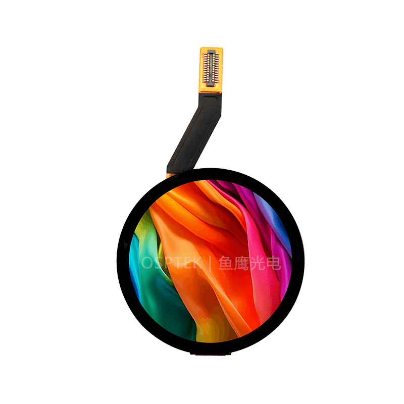

<p align="left"></p>

<h1 align="center">OSPTEK 1.04″ AMOLED Display 340×340 (AM104Q340340LK)</h1>

<p align="center"><b>AMOLED module · QSPI · SH8601A</b></p>

<p align="center"><a href="./README.md">简体中文</a> | English · <a href="../../README_EN.md">Family index</a></p>

<p align="center">
  
  
  
</p>

<p align="center"></p>

## Contents

- [Specifications](#specifications)
- [Resources](#resources)
- [Repository layout](#repository-layout)
- [Buy](#buy)
- [Support](#support)

---

## Specifications

| Item | Spec |
| ---- | ---- |
| Size | 1.04 inch |
| Type | AMOLED |
| Resolution | 340×340 |
| Outline | 29.25 x 30.00 mm |
| Active area | 26.35 x 26.35 mm |
| Interface | QSPI |
| Driver IC | SH8601A |
| Touch IC | CST820 |

> Full outline, FPC definition, power, and timing follow the product datasheet / driver IC datasheet.

## Resources

| Category | File |
| ---- | ---- |
| Datasheet | [`CO_5300_Datasheet_V0_00_20230328_07edb82936.pdf`](./datasheets/CO_5300_Datasheet_V0_00_20230328_07edb82936.pdf) |
| Datasheet | [`DS_CST_820_V1_2_e0543732ca.pdf`](./datasheets/DS_CST_820_V1_2_e0543732ca.pdf) |
| Datasheet | [`AM104Q340340LK.pdf`](./datasheets/AM104Q340340LK.pdf) |
| CAD file | [`AM104Q340340LK2.dwg`](./cad/AM104Q340340LK2.dwg) |
| CAD file | [`OK-23GF024-04.pdf`](./cad/OK-23GF024-04.pdf) |

## Repository layout

```text
display-amoled-1.04inch-340x340/ # repo root (nav: ../../README_EN.md; sample projects under root examples/)
└── versions/
    └── AM104Q340340LK/        # full materials for this part number
        ├── README.md
        ├── README_EN.md
        ├── osptek.yml
        ├── images/
        ├── datasheets/       # product datasheet + driver/touch IC datasheets
        └── cad/              # outline/cover CAD
```

## Buy

See the [repo home page](../../README_EN.md#where-to-buy).

## Support

See the [repo home page](../../README_EN.md#support).

---

<p align="center"><sub>© 2026 OSPTEK · Materials in this repository are licensed under CC BY 4.0</sub></p>
